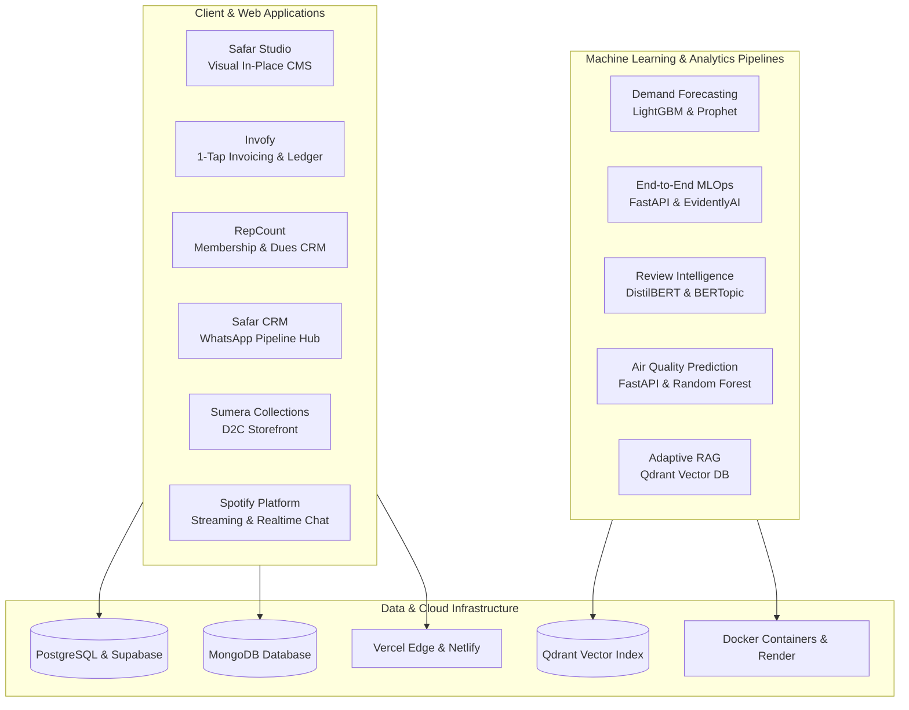

# Mohammed Minhaj Mahmood

Software and data systems engineer based in Telangana, India.

I build reliable web applications, operational business software, and production machine learning pipelines. My focus is on turning ambiguous requirements and messy datasets into clean, predictable software that works in real environments.

[Portfolio](https://mohammed-minhaj.netlify.app/) | [LinkedIn](https://www.linkedin.com/in/muhammadminhaj229) | [Resume](https://drive.google.com/file/d/1tpOBuj0llV3RuheG-z9btNNowmoK4MbP/view?usp=drivesdk) | [Email](mailto:minhajmuhammad229@gmail.com)

---

## Systems Architecture Overview

---

## How I Work

- **Ground decisions in the problem:** I select tools and frameworks to solve the specific operational problem rather than following trends. A simple, predictable architecture is easier to build, test, and maintain over time.
- **End-to-end execution:** I manage the full lifecycle of a system: data ingestion, database schema design, backend APIs, clean user interfaces, containerization, and production deployment.
- **Clarity over jargon:** Code must be maintainable, system behavior must be reproducible, and documentation should be easy to understand for any engineer or stakeholder.

---

## Production Web Applications

Live, deployed systems built for businesses, client operations, and media platforms:

- **Safar Studio:** An in-place visual content management system. Allows non-technical administrators to update web copy, announcements, and service listings directly on the live site without touching code. Built with React, Vite, Puck Editor, and Supabase.  
  [Code](https://github.com/MuhammadMinhaj229/crm-invoicing-hub) | [Live Deployment](https://safar-studio-snm.vercel.app)

- **Invofy:** A fast digital billing and receipt tool. Generates formatted PDF invoices, logs cash versus digital collections, and dispatches receipts directly to customers via WhatsApp. Built with Next.js 14, TypeScript, and Supabase.  
  [Code](https://github.com/MuhammadMinhaj229/invofy) | [Live Deployment](https://invofy-kappa.vercel.app)

- **RepCount:** A mobile-first membership management tool for gyms and fitness studios. Tracks fee cycles, membership expiries, and generates one-tap WhatsApp renewal alerts to eliminate paper registers. Built with React, Vite, and Supabase.  
  [Code](https://github.com/MuhammadMinhaj229/e-repcount-gym-payment-manager) | [Live Deployment](https://e-repcount-gym-payment-manager.vercel.app)

- **Safar CRM:** A multi-agent customer inquiry management hub. Integrates incoming WhatsApp conversations with shared team inboxes, automated greeting workflows, and pipeline stages. Built with Next.js, XYFlow, and Supabase.  
  [Code](https://github.com/MuhammadMinhaj229/safar-crm) | [Live Deployment](https://safar-crm-theta.vercel.app)

- **Sumera Collections:** A direct-to-consumer Indian ethnic wear e-commerce storefront. Features real-time Firestore catalog synchronization, category filtering, and Google Gemini API assisted product search. Built with React, Vite, and Firebase.  
  [Code](https://github.com/MuhammadMinhaj229/sumera_collections) | [Live Deployment](https://sumeeracollections.vercel.app)

- **Spotify Music Platform:** A full-stack music streaming web application with continuous audio playback, user playlists, and real-time social chat between listeners. Built with React, Node.js, Express, MongoDB, and Socket.io.  
  [Code](https://github.com/MuhammadMinhaj229/SPOTIFY-PROJECT) | [Live Deployment](https://spotify-project-bc53.onrender.com)

- **Data Automation Studio:** An in-browser longitudinal data quality and analysis studio. Validates datasets and generates CONSORT flow diagrams on-device using client-side Web Workers, ensuring sensitive files never leave the browser. Built with Next.js and TypeScript.  
  [Code](https://github.com/MuhammadMinhaj229/data-automation-studio) | [Live Deployment](https://data-automation-studio-orpin.vercel.app)

- **THAKSA E-Learning:** A full-stack learning management platform for workshops and student projects, featuring live session tracking, course approval pipelines, and attendance logging. Built with React, Node.js, Express, and PostgreSQL.  
  [Code](https://github.com/MuhammadMinhaj229/THAKSA_E-LEARNING) | [Live Deployment](https://thaksaelearningplatform.vercel.app)

- **SAFAR N MANZIL:** A travel guidance and housing assistance portal for professionals and families moving between India and the Gulf countries. Built with semantic HTML5, CSS3, and JavaScript.  
  [Code](https://github.com/MuhammadMinhaj229/safar) | [Live Deployment](https://safar-rouge.vercel.app)

- **Alif Growth:** A digital business operating system platform featuring an interactive tech team comparison suite and industry transformation matrices. Built with TanStack Start, React 19, and Tailwind CSS.  
  [Code](https://github.com/MuhammadMinhaj229/Alif-Growth-Media) | [Live Deployment](https://alif-growth.netlify.app)

---

## Machine Learning, Data Science and MLOps

Production predictive models, statistical frameworks, and data pipelines with live demo interfaces:

- **Demand Forecasting Pipeline:** A production-grade time-series forecasting engine comparing LightGBM, Prophet, and ARIMA. Features MLflow experiment logging, a FastAPI prediction endpoint, and an interactive Streamlit dashboard.  
  [Code](https://github.com/MuhammadMinhaj229/demand-forecasting-timeseries) | [Live Dashboard](https://demand-forecasting-timeseries-2c28agejbap9ell2fr9owv.streamlit.app/)

- **End-to-End MLOps Pipeline:** A production machine learning architecture covering data ingestion, model training, FastAPI serving, Docker containerization, EvidentlyAI data drift monitoring, and GitHub Actions CI/CD.  
  [Code](https://github.com/MuhammadMinhaj229/end-to-end-ml-pipeline) | [Live Dashboard](https://end-to-end-ml-pipeline-nqkrhynite6pfvygrzlm92.streamlit.app/)

- **NLP Review Intelligence:** An NLP pipeline applying fine-tuned DistilBERT for sentiment classification and BERTopic for semantic topic modeling across 500,000 Amazon customer reviews.  
  [Code](https://github.com/MuhammadMinhaj229/nlp-review-intelligence) | [Live Dashboard](https://nlp-review-intelligence-l4vsrtkyi828h8s2dyjxhr.streamlit.app/)

- **Indian Air Quality Prediction:** A multi-city Air Quality Index (AQI) prediction platform combining Random Forest regression and classification models, served through a FastAPI backend and connected to a responsive web interface.  
  [Code](https://github.com/MuhammadMinhaj229/Indian-Air-Quality-Prediction) | [Live Deployment](https://indian-air-quality-prediction.vercel.app)

- **Customer Segmentation:** An unsupervised clustering workflow using K-Means and Principal Component Analysis (PCA) to identify distinct customer behavioral segments, deployed as an interactive Streamlit app.  
  [Code](https://github.com/MuhammadMinhaj229/customer-segmentation) | [Live Dashboard](https://customer-segmentation-efb7gqwwg2sqdzpymxxbz5.streamlit.app/)

- **Vision-Based Terrain Classification:** A computer vision deep learning pipeline trained to classify terrain types from visual sensor feeds, with an interactive Streamlit testing interface.  
  [Code](https://github.com/MuhammadMinhaj229/Vision-Based-Terrain-Classification) | [Live Dashboard](https://vision-based-terrain-classification-bfzfgwhcu8npbf6lyipfyh.streamlit.app/)

- **Causal Inference and Uplift Modeling:** A rigorous statistical testing framework for experiment design, sample size determination, hypothesis evaluation, and two-model uplift estimation.  
  [Code](https://github.com/MuhammadMinhaj229/ab-testing-uplift-modeling)

- **Adaptive RAG Architecture:** An advanced retrieval-augmented generation system with dynamic query routing, document reranking, and vector indexing using Qdrant.  
  [Code](https://github.com/MuhammadMinhaj229/Adaptive-Rag)

---

## Technical Skills

- **Languages:** Python, TypeScript, JavaScript, SQL, HTML5, CSS3
- **Web Development:** React, Next.js, Vite, Node.js, Express, FastAPI, Tailwind CSS, TanStack Router, REST APIs, WebSockets
- **Data Science and Machine Learning:** Scikit-learn, Pandas, NumPy, LightGBM, Prophet, PyTorch, Hugging Face Transformers, OpenCV, Streamlit, MLflow, EvidentlyAI
- **Databases and Infrastructure:** PostgreSQL, MongoDB, Supabase, Firebase Firestore, Docker, Vercel, Netlify, Render, Linux, Git, GitHub Actions

---

## Resume and Contact

- **Portfolio:** [mohammed-minhaj.netlify.app](https://mohammed-minhaj.netlify.app/)
- **Resume:** [View on Google Drive](https://drive.google.com/file/d/1tpOBuj0llV3RuheG-z9btNNowmoK4MbP/view?usp=drivesdk) | [Direct Download](https://drive.google.com/uc?export=download&id=1tpOBuj0llV3RuheG-z9btNNowmoK4MbP)
- **LinkedIn:** [linkedin.com/in/muhammadminhaj229](https://www.linkedin.com/in/muhammadminhaj229)
- **GitHub:** [github.com/MuhammadMinhaj229](https://github.com/MuhammadMinhaj229)
- **Email:** [minhajmuhammad229@gmail.com](mailto:minhajmuhammad229@gmail.com)
